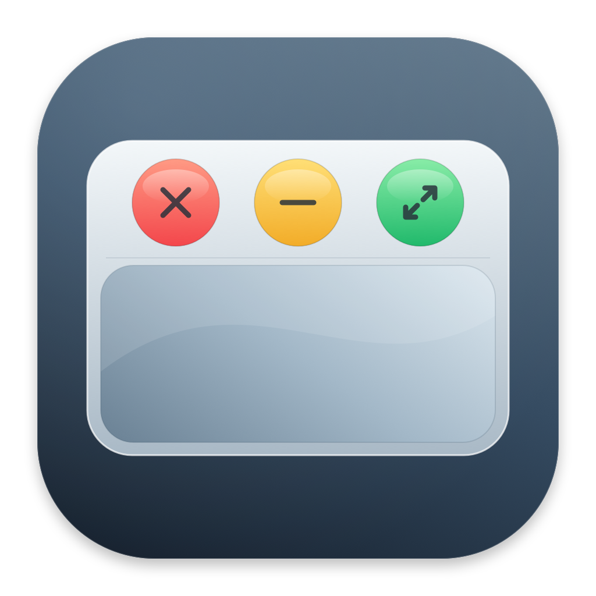

<p align="center"><strong>Aplicativo gratuito para macOS · versão 0.1.3 · build 10</strong><br>Swift · AppKit · Apple Silicon e Intel</p>



O Trio amplia os controles de fechar, minimizar e maximizar na região original da janela. Os botões ficam mais fáceis de enxergar e alcançar, com uma onda de ampliação ao passar o mouse.

**[Baixar Trio para macOS](https://raw.githubusercontent.com/Benfic4rthur/Trio/main/distribution/Trio-macOS-universal.zip)** · [Instalação passo a passo](docs/INSTALLATION.md) · [Histórico e novidades](CHANGELOG.md)

O aplicativo pronto não exige Xcode nem uma conta Apple Developer do usuário. O pacote Universal inclui Apple Silicon e Intel. A versão atual tem assinatura local e não é notarizada pela Apple; a primeira abertura pode exigir aprovação manual do macOS.

## Instalação

1. **Baixe e extraia o ZIP.** Abra a pasta `Trio-macOS-universal`, que contém `Trio.app`, `Install.command` e o guia de instalação.
2. **Execute `Install.command`.** Ele verifica o app, copia somente o Trio para Aplicativos e preserva a versão anterior. Se estiver atualizando, use **Encerrar Trio** antes de instalar.
3. **Abra o Trio.** Se o macOS avisar que não pode verificar o desenvolvedor, e você confiar na origem, use **Ajustes do Sistema → Privacidade e Segurança → Abrir Mesmo Assim**. Interrompa se houver alerta de malware ou arquivo danificado.
4. **Permita Acessibilidade** para o Trio nas configurações. Depois, use **Esconder Trio** para manter os controles funcionando sem a janela de ajustes.

O instalador não pede administrador, não remove a quarentena nem desativa proteções. Se `/Applications` não permitir escrita, ele usa `~/Applications` e informa o caminho. Também é possível arrastar `Trio.app` para Aplicativos pelo Finder. [Guia completo em português, inglês e espanhol](docs/INSTALLATION.md).

## Controles de janela

| Controle | O que faz |
| --- | --- |
| Vermelho | Encaminha o clique ao botão original, preservando a integração testada com Smart Close. |
| Amarelo | Minimiza pelo controle original. |
| Verde | Maximiza dentro da área útil do monitor, sem tela cheia; outro clique restaura a geometria anterior. |
| Mouse sobre o verde | Abre opções para maximizar, organizar em metades ou centralizar. |
| Botão direito | Abre o menu com **Abrir Trio**, sem executar uma ação da janela. |

Fechar e minimizar exigem clique. O tamanho solicitado pode ser configurado entre **1× e 5×**, com ajuste ao espaço disponível. A preferência inicial é **1,5×**, e atualizações preservam o tamanho já escolhido; no Codex medido, os controles de 16 pontos passam a 24 pontos. A área termina até cinco pontos depois do verde original, preservando ferramentas próximas.

Os círculos em repouso ficam nos centros dos controles originais e cobrem os botões pequenos. O desenho usa cores explícitas em sRGB: vermelho `#FF5F57`, amarelo `#FFBC2E` e verde `#28C840`, sem a mistura branca usada em iterações anteriores. A área ao redor é quase transparente. Durante movimento que não possa ser acompanhado com segurança, o Trio oculta os controles e os reapresenta após confirmar a posição.

## Silencioso durante o uso

O Trio pode iniciar com a sessão sem abrir as configurações. Abrir o app manualmente mostra os ajustes da instância existente. **Esconder Trio** mantém o auxiliar ativo; **Encerrar Trio** termina o aplicativo.

Dock e barra de menus vêm desativados para o uso em segundo plano e podem ser habilitados nas configurações. Também é possível abrir os ajustes pelo botão direito na área dos controles.

**Abrir novas janelas maximizadas** é uma preferência opcional, com lista de exceções por aplicativo. Alertas e janelas que não permitem redimensionamento recebem tratamento conservador.

## Versão atual e últimas mudanças

| Versão | Build | Data | Destaques |
| --- | --- | --- | --- |
| **0.1.3** | **10** | **15/11/2026** | Cliques parados na barra mantêm o Trio visível; ocultação apenas no arrasto. |
| 0.1.2 | 9 | 15/11/2026 | Retomada após bloqueio, alinhamento quando a barra muda e limpeza do desenho da onda. |
| **0.1.1** | **8** | **14/11/2026** | Identidade de janelas coincidentes, troca segura de foco e cores explícitas em sRGB. |
| 0.1.0 | 7 | 14/11/2026 | Controles ampliados, onda de hover, menu de organização, Smart Close, exceções de maximização automática e início silencioso. |

A build 10 separa clique de arrasto na barra: pressionar sem mover mantém os controles. A reprodução anterior registrou 56 amostras sem painel; a versão instalada registrou zero em 72 amostras e manteve a ocultação durante o arrasto real. [Correção e limites](docs/TITLEBAR-0.1.3.md).

A build 9 reconstrói os controles ao retomar a sessão e acompanha a posição dos botões mesmo quando a moldura da janela não muda. O bloqueio/desbloqueio real foi confirmado pelo usuário; os testes de desenho, retomada simulada, dez cliques de conteúdo e ações na versão instalada passaram. [Correção e evidências](docs/RECOVERY-0.1.2.md).

A build 8 corrigiu a seleção de janelas do mesmo aplicativo com a mesma geometria, situação comum ao abrir várias janelas maximizadas. O Trio só aceita essa identificação após comprovar por Acessibilidade os três controles da janela ativa. Um ensaio com 15 janelas coincidentes e 16 trocas de foco confirmou o alinhamento e a identidade. O início silencioso continua usando `SMAppService.loginItem`. [Histórico completo](CHANGELOG.md).

O ZIP em [`distribution/`](distribution/) é o pacote real compilado localmente, com [checksum SHA-256](https://raw.githubusercontent.com/Benfic4rthur/Trio/main/distribution/Trio-macOS-universal.zip.sha256) e [metadados de versão](distribution/release.json). É uma distribuição pública pelo repositório; não é uma GitHub Release. O código-fonte é público e não usa GitHub Actions ou builds remotos.

## Validação e compatibilidade

- **25 testes passaram.** Incluem geometria, limites de espaço, obstáculos, dimensões inválidas, coordenadas negativas, cobertura concêntrica e identificação conservadora de janelas coincidentes.
- **Build 8 instalada e exercitada** em macOS 27.2.1, M1 Pro. O pacote e o auxiliar contêm arm64 e x86_64; hardware Intel ainda não foi testado.
- **Smart Close 0.4.2, build 8:** com duas janelas coincidentes, o vermelho fechou somente a janela alvo e preservou o processo; o vermelho na última janela encerrou a fixture pelo Smart Close. Os cliques reais passaram pelos controles Trio e pelos botões originais. No ensaio anterior de comparação, `AXPress` direto teve comportamento diferente, mantendo o processo vivo. [Ensaio documentado](docs/SMART-CLOSE.md).
- **Janelas coincidentes:** 15 janelas da fixture própria e 16 trocas de foco passaram, com painel alinhado e identidade AX dos três controles. Dois cliques no verde da build 8 restauraram e maximizaram a mesma janela entre as 15, com CG e AX concordando, sem fullscreen ou painel visível desalinhado. Na build 8, o amarelo minimizou somente o alvo em dois cliques, mantendo a outra janela normal; os dois cliques vermelhos preservaram a regra de primeira/última janela do Smart Close. Os ensaios de arrasto das builds anteriores permanecem identificados separadamente. [Resultados e escopo](docs/PIPELINE-VALIDATION.md).
- **Início silencioso:** o registro por LoginItem abriu a instância do Trio sem configurações, em modo acessório, preservando a autorização de Acessibilidade. Uma sessão completa de sair/entrar no macOS ainda não foi exercitada.
- A sobreposição foi observada no **Codex** e no **Finder**. Regiões ocupadas por indicadores de compartilhamento ou ferramentas próximas podem ser recusadas.

A cobertura atende à **janela ativa compatível**. APIs públicas não permitem alterar os controles nativos de todos os aplicativos; o Trio usa uma sobreposição própria, sem injeção de código. Barras personalizadas e informações AX incompletas podem limitar a cobertura. Monitores adicionais, Spaces, hardware Intel e outras versões do macOS continuam na matriz de testes. O destino mínimo de compilação é macOS 13; isso não equivale a teste físico em todas essas versões.

## Compilar localmente

Para desenvolver, use Xcode com as ferramentas de desenvolvimento selecionadas:

```sh
./scripts/build-app.sh
./scripts/package-release.sh
```

O primeiro script compila o app e o auxiliar para arm64 e x86_64 e verifica a assinatura local. O segundo cria o ZIP, o checksum e os metadados. A assinatura padrão é ad-hoc; `TRIO_SIGN_IDENTITY` seleciona um certificado local. Um certificado local não transforma o pacote em software notarizado.

| Material | Conteúdo |
| --- | --- |
| [Instalação](docs/INSTALLATION.md) | Passos para o usuário e aprovação normal do macOS, em PT/EN/ES. |
| [Histórico](CHANGELOG.md) | Versões e últimas mudanças. |
| [Estado e limites](docs/STATUS.md) | O que foi verificado e o que continua pendente. |
| [APIs públicas](docs/API-RESEARCH.md) | Pesquisa técnica e limites das APIs. |
| [Smart Close](docs/SMART-CLOSE.md) | Interceptação e comparação dos caminhos de clique. |
| [Ensaios de execução](docs/PIPELINE-VALIDATION.md) | Resultados por build, sem extrapolar a cobertura. |
| [CPU e memória](docs/PERFORMANCE.md) | Amostra de repouso com unidade Mach e pegada física separada do RSS. |
| [Ícone final](docs/branding/trio-icon-final.png) | Arte do app em 256, 128 e 64 pixels. |
