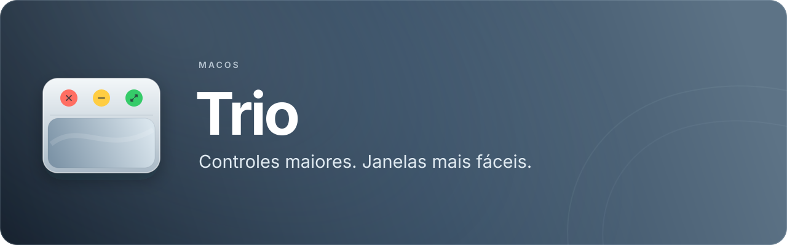

<p align="center"><strong>Protótipo em validação</strong><br>Swift · AppKit · macOS · Apple Silicon e Intel</p>


Os controles de fechar, minimizar e maximizar podem ser pequenos demais para enxergar e alcançar com conforto. O Trio explora controles maiores na mesma região da janela, com aparência discreta e áreas de clique ampliadas.

O protótipo usa APIs públicas e uma sobreposição conservadora. Sua cobertura inicial é a janela ativa que passar pelas verificações de identidade, geometria e Acessibilidade. Aplicativos com barras próprias podem exigir adaptações ou permanecer com os controles originais.

## Como o Trio funciona

| Controle | Comportamento implementado no protótipo |
| --- | --- |
| Vermelho | Encaminha um clique ao botão original, preservando o caminho observado pelo Smart Close. |
| Amarelo | Encaminha o clique ao controle original de minimizar. |
| Verde | Maximiza na área útil do monitor; outro clique restaura o tamanho anterior. O hover abre opções de organização. |
| Botão direito | Abre o menu com **Abrir Trio**, sem executar uma ação da janela. |

Fechar e minimizar exigem clique. A ampliação em onda acompanha o mouse e respeita a região reservada aos controles. A preferência inicial é **1,5×**, configurável de **1× a 5×**; o tamanho efetivo diminui quando o espaço disponível exige.

As configurações também oferecem **Abrir novas janelas maximizadas**, limitado às janelas que permitam redimensionamento. Alertas e caixas de diálogo são preservados.

## Discreto durante o uso

O início com a sessão usa um auxiliar silencioso. Abrir o Trio manualmente mostra as configurações da instância existente. **Esconder Trio** mantém os controles funcionando; **Encerrar Trio** termina o auxiliar.

Dock e barra de menus são opcionais e vêm desativados para o uso em segundo plano. A Acessibilidade é solicitada pelo botão das configurações. O motor usa notificações de janelas, aplicativos e telas para reagir às mudanças.

## O que já foi verificado

- **16 testes de geometria** passaram, cobrindo limites de espaço, ferramentas próximas, posições de monitores e a máscara dos controles originais.
- **Smart Close 0.4.2:** em uma janela AppKit descartável, `AXPress` fechou a janela e manteve o processo; o clique HID no botão original encerrou o aplicativo pelo caminho do Smart Close. [Detalhes do ensaio](docs/SMART-CLOSE.md).
- Configurações e componentes da interface passaram por verificação de tipos em **arm64 e x86_64**. Ícones e estudos visuais foram renderizados e inspecionados localmente.

O teste do clique original ainda não valida o fluxo completo iniciado na sobreposição. Alinhamento e interação reais no Codex e em outras barras, minimização, restauração, Spaces, troca de monitor e início de sessão continuam em validação. Compilar para Intel também não substitui testar em um Mac Intel.

## Compilar localmente

Requer Xcode com as ferramentas de desenvolvimento selecionadas. O destino mínimo do projeto é macOS 13; o ambiente de desenvolvimento atual usa macOS 27.2.1, Apple Silicon e Swift 6.4.2.

```sh
./scripts/build-app.sh
```

O script compila para **arm64 e x86_64**, reúne as duas arquiteturas em `build/Trio.app`, inclui os recursos do aplicativo e verifica a assinatura local. O bundle fica disponível para revisão antes da instalação. A compilação anterior é preservada em `build/Trio.previous*.app`.

A assinatura padrão é ad-hoc. Para usar um certificado local estável durante o desenvolvimento, defina `TRIO_SIGN_IDENTITY` antes de executar o script. Mudanças na identidade de assinatura podem exigir renovar a autorização de Acessibilidade.

Ainda não há download público nem release de instalação. O repositório é privado, com backup de código pelo GitHub e compilação local, sem GitHub Actions ou builds remotos.

## Limites conhecidos

- APIs públicas não permitem redimensionar os controles nativos de todos os outros aplicativos. A sobreposição é uma implementação em avaliação.
- A área reservada termina até **5 pontos após o verde original**, com crescimento em direção à borda esquerda. O Trio recusa regiões ambíguas ou sem espaço seguro.
- A máscara precisa ocultar os botões pequenos. Uma cor opaca pode divergir de barras personalizadas, materiais translúcidos e temas próprios; a aparência ainda exige validação por aplicativo.
- A cobertura inicial atende à **janela ativa**. Janelas sem três controles acessíveis, geometria confiável ou redimensionamento permitido recebem tratamento conservador.
- O vermelho usa o evento de mouse original como referência. Não há fallback silencioso para `AXPress` nem comando direto de encerrar para imitar o Smart Close.
- Monitores adicionais, Spaces, login real e hardware Intel ainda precisam de testes físicos.

## Desenvolvimento e próximos passos

| Material | Conteúdo |
| --- | --- |
| [Estado da validação](docs/STATUS.md) | Evidências e trabalho pendente. |
| [APIs públicas](docs/API-RESEARCH.md) | Documentação Apple e limitações encontradas. |
| [Smart Close](docs/SMART-CLOSE.md) | Inspeção da versão instalada e comparação dos caminhos de clique. |
| [Núcleo de geometria](Sources/TrioCore/Layout.swift) | Cálculo da área segura e ajuste de tamanho. |
| [Fixture descartável](Tools/CompatibilityFixture.swift) | Janelas AppKit padrão e personalizadas para ensaios. |

O próximo marco é validar o fluxo da sobreposição em aplicativos reais e registrar uma matriz de compatibilidade. Uma página de apresentação no catálogo ALLM4 e downloads públicos ficam para uma etapa futura, após essa validação.
